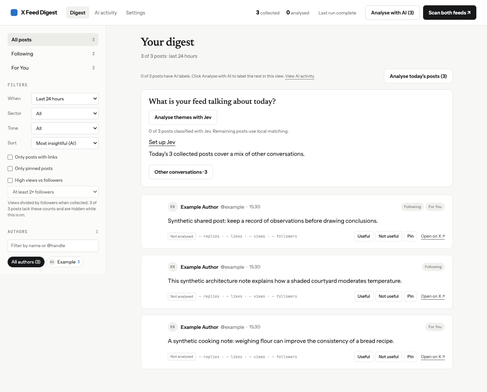
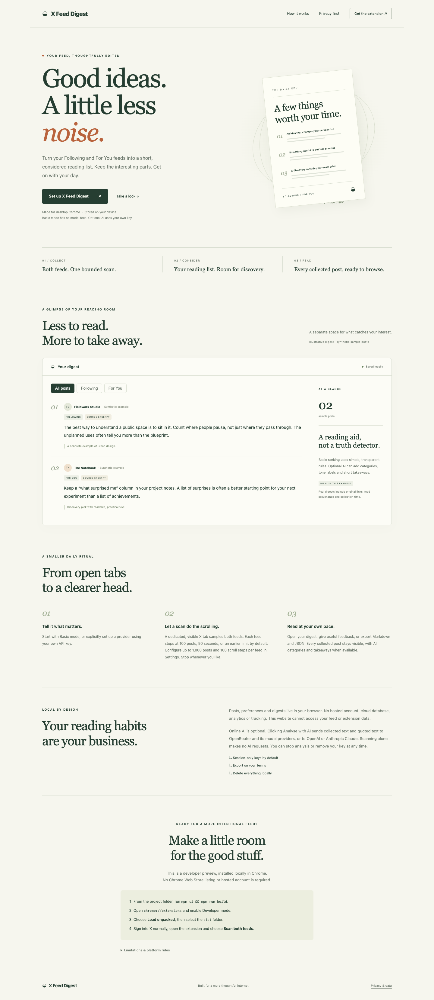

# Feed Digest

An unofficial reader for X (Twitter).

Not affiliated with or endorsed by X Corp.

A TypeScript Chrome extension that samples Following and For You into a local reading digest. A separate static Vite website is ready for Vercel; the website never receives feed data or API keys. No Next.js, backend, cloud database, shared model key or hosted account.

**Developer preview, not a verified live-X release.** Browser integration tests use synthetic X pages. Real X selectors, real provider requests, unattended scheduling, and Windows/Linux behavior need the manual smoke tests below. X explicitly prohibits non-API automation, including website scripting, and warns of account suspension in its [automation rules](https://help.x.com/en/rules-and-policies/x-automation). DOM access does not establish compliance. Resolve platform-rule compatibility before public release.

## Build and install

Node 22.12+ (Node 24 recommended), npm, desktop Chrome 120+.

```sh
npm ci
npm run typecheck
npm test
npm run build
```

Open `chrome://extensions`, enable **Developer mode**, click **Load unpacked**, select this project's `dist/`. Basic mode works immediately. Sign into X normally, then press **Scan both feeds** in the popup. A new visible X tab is used and closed after collection; the digest opens separately. Existing reading tabs are not scrolled or closed. Keep the scan and digest monitor tabs open until finished. Stop preserves collected data.

Chrome 120 is the declared minimum for one-minute recovery alarms, trusted-only storage access, promise-based extension APIs, and the modern browser APIs used by the extension. The tested Chromium version is recorded in `docs/VALIDATION.md`; minimum-version and cross-platform testing remain release tasks.

## What is implemented

- English accessible feed selection and a conservative transition barrier: outgoing cards must leave the DOM before incoming-feed attribution. Ambiguous transitions stop that feed.
- Preferences save automatically as you edit. Invalid values leave the last saved value intact; save status appears below Scan settings. API keys are saved after a successful **Check connection**, or explicitly with **Save key**.
- Optional **Settings → Scan settings → Hide post images while scanning** collapses photos, image previews and avatars only in the dedicated scan tab, including newly loaded cards. Inline emoji and post text remain visible. Off by default; applies to the next scan. This may reduce rendering work but does not block downloads or guarantee faster collection. No additional permissions are required.
- A feed checkpoint saves the newest collected Following post after each completed scan. Later scans stop at that post (including it), so they mostly collect what is new. The checkpoint always advances to the newest post of the latest completed scan; if a limit stops a scan before it reaches the old checkpoint, the posts in between are not collected and the scan reports that the previous checkpoint was not encountered. For You is not in date order, so it has no checkpoint and always runs to your limits. X may reorder or remove posts; this is not an exact scroll-position guarantee or a new-posts-only mode. **Settings → Scan settings → Reset scan checkpoints** clears the boundaries so the next scan can go deeper. Checkpoints are account-bound and Delete all data clears them.
- Default limits per feed: 100 distinct posts, 90 seconds, 30 scrolls, or three cycles without new IDs, whichever occurs first. Settings allow up to 1,000 posts and 100 scroll steps; the time limit remains capped at 90 seconds. Total scan deadline plus bounded readiness/switch overhead. Each scroll pauses for a randomly chosen 1.5–3 seconds, shortened at the collection deadline. Mutation observation captures virtualised cards and incremental batches are saved atomically.
- Automatic caching: unchanged cards reuse parsed data within each feed scan; DOM changes invalidate it. AI assessments are cached per post for 30 days and reused across scans even if batch order changes. Changed text, quotes, provider, model or prompt version trigger fresh analysis. Digests report cache hits. Feed loading and scroll delays still apply; live speed gains are unmeasured.
- IndexedDB posts, observations, runs, digests, feedback, ranking cache and usage reservations. Persisted leases reject stale content-script messages and overlap. Interrupted runs retain Basic digests and captured posts.
- Scanning adds new posts to **All saved posts**, deduplicated by post ID. Earlier scans remain visible within the selected date and display filters. **Scan history → Saved posts** lets you explicitly inspect the latest scan or an individual older scan.
- Every collected post appears in the digest. Basic scores and reversible author affinity affect ordering only; no score threshold, author cap or duplicate-text filter hides posts. Basic shows source excerpts, never AI summaries.
- OpenRouter free-only and paid OpenAI/Claude adapters, explicit opt-in, model checks, bounded requests, schema validation, fallback, content/profile/model/prompt cache, and a separate extension-page ranking lifecycle.
- Digest sorting: newest/oldest post date, most comments, most likes, AI insight score or pinned first. The sort choice saves automatically and works with feed filters; it reorders all collected posts. Dates/counts appear on each card. Counts reflect collection time and can be rounded by X; missing values sort last. Older stored posts need a new scan for comment counts.
- **High views vs followers** filter: enable it in the digest to require views ≥ 2× follower count, with 5× and 10× options. Unknown counts and zero-follower accounts are excluded while enabled. Counts are approximate collection snapshots. Scans read rendered view counters and attempt author hover-card follower lookups (one attempt per author, up to 1 second each and 12 seconds total within scan deadlines). Some posts will remain unknown; older posts need rescanning, and live-X hover-card behavior remains unverified. No additional API or AI requests are used for these metrics.
- Feed filters, original links, collection context, pinning, feedback reset, Markdown/JSON export and manual Copy AI prompt. A manual prompt includes up to ten posts; it does not provide scheduled AI digests.
- Start scans manually. Daily scheduling has been removed; leftover schedule settings and alarms from older versions are cleared. The one-minute recovery alarm runs only while a scan or analysis is active.
- Retention of 30 days and a 5,000-post cap for unpinned data. Pinned data is exempt. Delete all data removes settings, credentials, usage, cached responses, feedback, digests, posts and alarms.

## Provider setup

**Basic:** leave the default mode selected. No model requests or model fee. X collection does not use the paid X API; this says nothing about platform compliance.

**OpenRouter:** choose Free online AI → enter your own key → Check connection (approve access if Chrome asks; current free models load automatically) → collect posts with Scan → click Analyse with AI. Only the selected origin receives permission. The first free model is selected if no valid selection exists; you can choose another and check again. Every generation refreshes pricing; missing/unknown/nonzero pricing blocks calls. No fallback model list, tools or paid provider fallback is enabled. Availability and free quotas vary. [OpenRouter free variants](https://openrouter.ai/docs/guides/routing/model-variants/free), [limits](https://openrouter.ai/docs/api/reference/limits), [privacy](https://openrouter.ai/privacy).

**Claude:** create an Anthropic Console API key (see [API setup](https://platform.claude.com/docs/en/api/overview)). In Settings choose **Claude API · Anthropic · paid**, select **Claude Haiku 4.5**, enter your key and click **Check connection** and approve provider access if Chrome asks. A successful check verifies the setup. After collecting posts, click Analyse with AI beside Scan. Preferences save automatically; no price or daily spend fields are required. [Claude subscriptions do not include API usage](https://support.claude.com/en/articles/9876003-i-have-a-paid-claude-subscription-pro-max-team-or-enterprise-plans-why-do-i-have-to-pay-separately-to-use-the-claude-api-and-console). No key belongs in Vercel or source code; this is your own key, stored in trusted extension storage. The connection check calls the Models API without generation. Its button shows Checking… while busy, then displays success or an actionable error beside the button; network checks time out after 15 seconds. Real account access/CORS remains to be smoke-tested with your own key; fixture tests spend no credits.

AI-analyzed posts can receive up to three sector labels (finance, health, technology and others) and two tone labels (humour, dramatic, informative, analytical and others). Digest filters combine sector, tone, feed and links-only selection. These are subjective model estimates, not facts; Basic/legacy results can remain unclassified. All collected posts are eligible for analysis, subject to request/token/time limits. Posts without AI results remain visible with their source text. Prompt version 9 asks for scores, sectors, tones and explicit buy/sell calls. Older classifications need fresh analysis to add recommendation tags.

Rendered outgoing links are surfaced separately on each card and included in exports, with post/quote/reply context. The scanner does not follow links or open comment threads. Reply links appear only when the reply itself is collected in a feed. Rendered full destination titles replace t.co URLs when available; otherwise the short link remains. Old records need recollection to populate links. **Copy AI prompt** also works for manually pasting into Claude, but replies are not imported automatically.

**OpenAI:** select OpenAI API, select GPT-4.1 mini or nano, enter a user key and click Check connection; approve provider access if Chrome asks. After checking the connection, collect posts and click Analyse with AI. No manual pricing or daily spend ceiling is required; API usage is billed directly by OpenAI.

Keys default to session-only trusted extension storage. **Remember key** survives restart but is not an encrypted vault. Keys are never sent to X, content-script messages, prompts or exports. Remove keys clears both stores. Missing keys after restart cause Basic fallback.

Online analysis processes collected posts in batches of up to 10, sequentially, within the internal request/token/time limits. Long text is bounded; large batches split into smaller requests; a post that exceeds the input limit alone stays visible without AI analysis. Manual analysis processes the complete selected saved-post view without the old six-request scan or twelve-request daily caps. Requests time out after 30 seconds; the overall deadline scales with collection size. Rate limits, server errors, timeouts and network drops are retried up to three times per batch, waiting for Retry-After (at most 30 seconds). A batch that still fails, or returns malformed or truncated output, is skipped and later batches continue; its posts stay pending. Three failed batches in a row, or a rejected key, model or price, stop analysis. Invalid individual labels or buy/sell tags are dropped without failing the batch; a post whose buy/sell check is missing stays pending and is not cached. Complete Markdown JSON fences are accepted, while the JSON schema and post IDs remain validated. Output allowance scales with batch size. Previous valid batches survive later failures. Scores and categories are unverified model judgments. Cross-digest novelty is not implemented; the UI/prompt disclose this.

## Vercel website

```sh
npm run dev            # local website
npm run build:site     # site-dist/
```

Import this project into Vercel when ready. The root `vercel.json` selects `npm run build:site` and `site-dist/`, with security headers. No environment variables or server functions are needed. `dist/` is the extension; **do not use it as the Vercel output directory**. No deployment or repository publication is included in this implementation.

The website preview uses invented sample posts. The optional **/reader** route displays your uploaded saved collection behind Basic Auth. [Vite on Vercel](https://vercel.com/docs/frameworks/frontend/vite).





## Tests and local release

```sh
npx playwright install chromium
npm run build
npm run build:site
npm run test:browser
npm run release
```

Playwright uses its extension-compatible Chromium / Chrome for Testing distribution (`channel: chromium`) with a temporary profile. Tests intercept synthetic X/provider traffic; they do not sign in, use real keys or spend credits. The provider browser test copies the extension into its temporary profile and pregrants only the mocked provider host (OpenRouter or Anthropic); the production manifest retains optional permissions. Native host-permission dialogs still require manual testing. No real browser profiles are accessed. ZIP creation includes only `dist/`, sorted with fixed timestamps, at `releases/x-feed-digest-0.1.0.zip`. Generated build/release files are gitignored. The npm lockfile belongs in version control. CI action commits are pinned; see `docs/ARCHITECTURE.md` for review links.

## Permissions and limitations

| Permission                                     | Purpose                                                                          |
| ---------------------------------------------- | -------------------------------------------------------------------------------- |
| `storage`                                      | Local settings, session/persistent user keys, digest view preferences            |
| `alarms`                                       | Best-effort daily trigger and expired-run recovery                               |
| `scripting`                                    | Inject the bundled scanner only into the owned X home tab                        |
| `https://x.com/*`                              | Chrome host access; runtime checks restrict reading to `/home`                   |
| optional OpenRouter / OpenAI / Anthropic hosts | Direct documented HTTPS model and connection/catalogue requests after user grant |

No cookies, broad tabs permission, network interception, arbitrary hosts, analytics, remote executable code, messaging/posting/liking actions, linked-article downloads or sync storage. One X account per browser profile; changed or unreadable visible identity blocks new collection until explicit reset. Use separate Chrome profiles for separate accounts.

Only rendered text is read. Images, video, full threads and external articles are not understood. Feed sampling and exact-phrase scoring can miss excellent posts. Live X layout changes, non-English labels, sign-in walls and challenges stop collection. Conservative feed transitions can reject feeds with persistent outgoing DOM nodes. Worker/page interruptions produce preserved Basic results, not automatic continued inference. Scheduled execution requires Chrome, awake device, signed-in X, visible rendering and explicit focus permission. No unlimited-free or universal unattended operation claim.

**Troubleshooting:** open digest for state and per-feed reasons. Check English UI and normal X sign-in; never bypass challenges. If the account changed, export any desired records and explicitly Delete all data or use another profile. For online failures verify the selected model, permission, key and request limits; collected data remains usable in Basic. Closing the required tab interrupts the run. Diagnostic export is previewable and excludes content/credentials.

See [manual QA](docs/MANUAL_QA.md), [architecture](docs/ARCHITECTURE.md), [privacy](PRIVACY.md), [security](SECURITY.md), and [validation record](docs/VALIDATION.md).

If Check connection reports a manifest permission mismatch, use **Open extension manager** beside the error, reload X Feed Digest and reopen Settings. Confirm the unpacked extension points to this project’s `dist/` folder. If it persists, **Copy permission details** captures only extension/provider IDs and declared/granted hosts, never keys or posts, for troubleshooting.

Check connection tests the key currently entered, or the stored key when the field is blank. A successful check saves a newly entered key using your Remember key choice. A failed check keeps the previous stored key. HTTP 401 messages identify the provider host so you can verify that the selected provider matches the key issuer.

Scan settings → **Stop scrolling at** offers the saved scroll point (default) or **24 hours before this scan**. The latter ignores saved checkpoints and uses one cutoff for both feeds. Posts at or before the cutoff are skipped, and a feed stops after three such posts in a row, so a single old repost or out-of-order For You post does not end the scan. Undated posts are collected and do not count toward the stop. Existing limits still apply. Date-based scans preserve existing checkpoints.

### AI activity

Open **AI activity** from the extension navigation or popup. New AI scans record input/output tokens, per-request USD cost, request status/duration/errors and post assessments and unanalysed post statuses; all collected posts remain in the digest. The page refreshes during scans; search post text/author/sector/tone, filter by analysis status, inspect each post, choose a previous scan, or export its JSON log. Locally cached assessments are identified and make no new request.

Charges are provider-reported when supplied, otherwise estimated automatically for supported models using standard token rates verified 27 September 2026: [Claude Haiku pricing](https://platform.claude.com/docs/en/about-claude/pricing), [GPT-4.1 mini pricing](https://developers.openai.com/api/docs/models/gpt-4.1-mini), [GPT-4.1 nano pricing](https://developers.openai.com/api/docs/models/gpt-4.1-nano). Estimates account for reported prompt-cache reads. Unsupported cache-write charges and missing usage remain unavailable. Totals with unknown attempts are marked partial; failed model-output validation still retains returned usage. Rates are bundled, not fetched dynamically; the provider bill remains authoritative. No manual pricing setup or budget fields are added.

Logs contain the bounded post/quote excerpts used for analysis, validated categories, tone, score and buy/sell metadata. Older logs may retain generated summaries and explanations. They contain no API credentials or raw provider responses, are stored with runs for 30 days, and are removed by Delete all data. Pre-existing scans cannot be backfilled. A request interrupted before its response is recorded has unknown usage/outcome. Connection checks and model-catalogue lookups are not generation attempts in this log.

The digest shows every collected post ID, including low-scored, short, repeated-text and unanalysed posts. Not useful feedback no longer hides posts. Existing digests display all still-stored posts for their scan, and exports include them. Feed/category/tone/link filters remain optional display controls. **Only pinned posts**, beside **Only posts with links**, shows pinned posts exclusively and combines with the other filters; pinning is not a sort option. The same post ID collected in both feeds appears once.

Digest display filters independently hide low AI scores (below 30/100), repeated text (normalised case/punctuation/links), posts beyond two per author, or posts marked Not useful. All default off and autosave. Duplicates/author limits keep the first posts in the current sorted and filtered view; Basic posts without AI scores stay visible. Reset these filters restores all four switches to off. A visible-post count shows the result. Stored posts and exports are unaffected.

Choose **Sort posts → Most insightful (AI)** to order by AI scores for useful detail, evidence described and explanatory value. Scores stay stored for sorting and can be inspected in AI activity; digest cards show original collected post text, its X link and available external links. Unanalysed posts stay visible after scored posts, including those scored zero. The choice autosaves; insight is a subjective AI assessment, not fact verification. AI requests generate no takeaways or explanations.

**Analyse with AI** replaces the old checkbox in the digest and popup. Scan only collects posts. Click Analyse with AI to categorise unanalysed posts currently shown in the selected saved-post view, without reopening X. Click **Analyse today’s posts** to analyse unanalysed saved posts published from midnight to now in your local time, across all scans regardless of display filters. Alternatively, select **When → Today** and click **Analyse with AI** to respect the other selected filters. Posts without a publication date are excluded. **Analyse all saved posts** also includes posts hidden by your filters or selected scan. Setup is taken from current Settings. Each analysis has its own activity entry, preserves the original scan and feed attribution, and reuses cached assessments. Analysis runs do not replace **Latest scan** and are not listed in scan history. Keep its digest tab open until finished; Stop cancels analysis. Failures and unanalysed posts remain visible. Connection checks never start generation.

During AI analysis, the digest shows a progress bar with analysed/total posts and the current run’s USD cost. Counts include cached classifications. Cost updates after each response, includes failed attempts with reported usage, and labels estimates, pending requests and unavailable charges. The summary remains visible after completion or an error.

Select **Sector → Finance** to reveal **Buy/sell calls** and **Asset type**. Switching away clears those filters. Use **Buy/sell calls** to show buy, sell, or either recommendation, and **Asset type** for stocks, crypto, funds, commodities, forex or other assets. Filters combine with author, sector, tone and feed filters. AI tags explicit, asset-specific recommendations, including conditional calls, rather than historical trades or price predictions. Cards continue to display only collected source content. Detection is an AI interpretation and may miss or misclassify a call. **Not checked yet** distinguishes older or unanalysed posts from posts checked with no recommendations. Click Analyse with AI to check existing posts; older cache versions are refreshed because they lacked this metadata.

Under **Hide posts from this view**, **Blacklisted words** accepts one literal word or phrase per line. Matching ignores case and checks any part of collected post and quoted text. Edits automatically save in local extension storage across sessions. Reset these filters clears the blacklist; exports retain every collected post.

Starting a new scan switches open digests to **Latest scan** and updates the post list and author counts, including scans started from the popup. Changing **When** or custom date bounds from Latest scan switches back to All saved posts, so older dates include earlier scans and refresh author counts. Explicitly selected dated scans keep their scope. New scans keep earlier saved posts in the existing on-device IndexedDB database. The digest defaults to **All saved posts**, deduplicated by post ID, retaining available AI classifications. **Saved posts** also offers Latest scan and dated individual scan/analysis entries. The digest's Analyse with AI uses that selection; the popup uses the latest run. Display filters do not limit analysis. The digest has no export panel; saved data remains in the local database. Existing retention still applies: 30 days and up to 5,000 unpinned posts, with pinned posts exempt.

The digest opens with publication-date filters from now minus 24 hours through now. **From** and **To** use local date/time; **When → Last 24 hours** restores the rolling default and **When → All** clears both bounds, including posts without a known publication time. Dates combine with the other display filters and do not delete stored posts or limit AI analysis.

The digest uses layout 2a: a sticky action/status header, a left rail with feed counts, a When menu (24 hours / 3 days / week / all / custom), category filters, searchable author chips and collapsed history/visibility sections. Single-post authors expand from the footer link or appear when searched. Below 900px, Filters opens a keyboard-accessible drawer. Instrument Sans, JetBrains Mono and Newsreader are bundled locally with their OFL licenses. Stored posts currently have no avatar/media image URLs, so author initials are shown and the redesign does not introduce image fetching.

The digest includes **What is your feed talking about today?** above the posts. It summarises the leading topics and counts for posts published from local midnight through now in the selected saved-post collection. Topic groups use local text matching (including quoted text) with available AI sector classifications as a fallback, requiring no additional model calls. Click a theme to show its relevant posts, click it again or **Clear theme filter** to restore the view. Themes combine with existing display filters; their counts describe the selected collection before those filters. Posts can belong to multiple themes; undated posts are excluded from today's overview.

### Jev theme matching

Reload the rebuilt extension in `chrome://extensions`, then open **Settings → Jev theme matching**. Enter your TypeSafe key in **Jev API key** and click **Save and check Jev connection**; approve TypeSafe host access. The check lists available models without sending post text. Session-only storage is the default; **Remember Jev key after Chrome restarts** opts into persistent extension storage. Jev is independent of the sector/tone analysis provider. Remove Jev key, Remove keys and Delete all data remove its credentials.

In the daily themes panel, click **Analyse themes with Jev**. This explicitly sends today's posts in the selected collection (including posts hidden by display filters), with up to 2,200 post characters and 600 quoted characters each, to TypeSafe. Nine independent Noul questions classify predefined topics by meaning; matches require a probability of at least 0.8, a provisional threshold. Jev generates no prose or new theme names. Completed results override local matching, including a checked post with no matching themes; pending/failed posts keep local matching. Cached results survive reloads and invalidate after content, theme-definition or model changes, or 30 days. Stop or close the tab to cancel; completed results remain saved. Progress shows cache reuse and a token-based USD estimate at the bundled Jev 1.13 input rate of $0.042/million tokens; missing usage is marked partial and the provider bill is authoritative. No automatic requests, other-provider fallback, backend or shared key is added. The fixed model is `jev-1.13.0`. The API integration uses [TypeSafe's documented endpoint](https://docs.typesafe.ai/api) and [models/pricing](https://docs.typesafe.ai/models), checked 2 October 2026. Browser tests mock TypeSafe; live account and host-permission behavior still need checking with your own key.

## Online reader with Basic Auth

The reader uses one username/password and one compressed snapshot file; no Supabase or user database. Browse posts at `/reader`, with search, date/sector filters, AI insight sorting, and Only pinned posts / Only posts with links. Reading and uploading require Basic Auth.

To update it, open **Scan history → Export for online reader** in the extension. At `/reader`, choose **Upload saved posts** and select the downloaded `.json.gz` file. Uploads replace the online copy across all scans; filters do not limit the export. AI keys and request logs stay local. Reading is read-only; online filters do not change Chrome data. Maximum file size is 4 MB compressed and 20 MB decompressed.

Local preview: copy `.env.example` to `.env`, set `READER_USERNAME` and `READER_PASSWORD`, then run `npm run dev` and open `http://127.0.0.1:5173/reader`. Local data is stored in gitignored `.reader-data/`. Never expose the local HTTP preview outside your machine.

Production on Vercel:

1. Connect a **private Vercel Blob store** to the hosting project. Use the automatically supplied `BLOB_STORE_ID`/OIDC credentials, or configure `BLOB_READ_WRITE_TOKEN` on the server. Public Blob stores are not supported.
2. Set server environment variables `READER_USERNAME` and `READER_PASSWORD`. Do not prefix them with `VITE_` or put them in browser code. Use a username without a colon.
3. Deploy this directory using the existing `vercel.json`. It builds both the install page and the reader and includes `site-dist/reader.html` in the reader function. Open `https://your-domain/reader` and enter the Basic Auth credentials.

Without credentials the reader fails closed with HTTP 503; unauthenticated requests get HTTP 401. The public install page remains available. Each upload overwrites `reader/saved-posts.json.gz` in the private store, so simultaneous uploads use the last successful write. Delete that object to remove the hosted copy; deleting Chrome data does not delete uploads.
